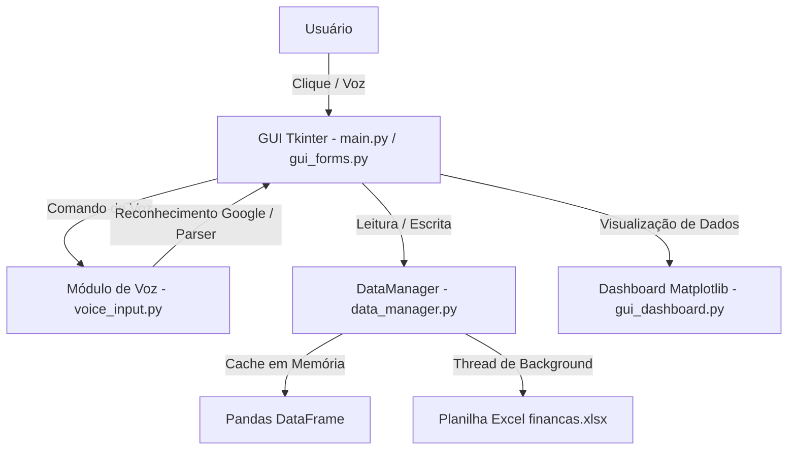

# 📘 Documentação do Sistema de Controle Financeiro Pessoal

Sistema desktop automatizado em Python para gestão e acompanhamento de receitas e despesas pessoais, com interface gráfica (Tkinter), integração de comando de voz por IA/reconhecimento de fala, armazenamento em planilha Excel e dashboard visual interativo.

---

## 📋 Sumário
1. [Visão Geral e Arquitetura](#-visão-geral-e-arquitetura)
2. [Estrutura de Arquivos](#-estrutura-de-arquivos)
3. [Funcionalidades Principais](#-funcionalidades-principais)
4. [Como Executar o Sistema](#-como-executar-o-sistema)
5. [Guia de Uso — Entrada por Voz](#-guia-de-uso--entrada-por-voz)
6. [Estrutura da Planilha Excel](#-estrutura-da-planilha-excel)
7. [Manutenção e Backups](#-manutenção-e-backups)

---

## 🏗️ Visão Geral e Arquitetura

O sistema adota uma arquitetura em camadas desacopladas com **processamento em memória** (in-memory caching) e escrita assíncrona no disco, garantindo interface ágil e sem travamentos.



---

## 📂 Estrutura de Arquivos

Todos os arquivos estão localizados na sua Área de Trabalho (`~/Desktop/controle-financeiro/`):

| Arquivo | Descrição |
|---|---|
| `main.py` | Ponto de entrada. Gerencia a janela principal, menu superior, abas e barra de status. |
| `gui_forms.py` | Formulário de entrada de dados, navegação de datas e tabela interativa de transações. |
| `gui_dashboard.py` | Dashboard financeiro com resumos numéricos e 3 gráficos (Pizza, Barras e Linha). |
| `voice_input.py` | Módulo de reconhecimento de voz via microfone e interpretador inteligente de frases. |
| `data_manager.py` | Camada de dados com cache em memória (Pandas) e gravação assíncrona em Excel. |
| `categories.py` | Definição de categorias padrão de entradas, saídas e formas de pagamento. |
| `utils.py` | Funções utilitárias (formatação de moeda R$, validações, datas e paleta de cores). |
| `financas.xlsx` | Banco de dados principal no formato Excel. |
| `backups/` | Diretório com cópias de segurança geradas automaticamente com data/hora. |
| `Controle Financeiro.command` | Atalho executável por duplo-clique na Área de Trabalho. |

---

## 🚀 Funcionalidades Principais

### 1. 🎤 Entrada de Dados Automatizada por Voz
- Captura áudio pelo microfone usando a API do Google Speech Recognition.
- **Interpretador Inteligente:** Extrai automaticamente Tipo (*Entrada/Saída*), Categoria (*Alimentação, Transporte, Salário...*), Valor numérico, Descrição e Forma de Pagamento (*Pix, Cartão, Dinheiro...*) a partir de uma frase natural.

### 2. 📝 Formulário com Navegação Rápida
- Preenchimento automático com a data atual.
- Botões de navegação dia a dia (`◀`, `▶`, `Hoje`).
- Validação automática de valores em Real (R$).
- Alternância dinâmica de categorias com base no tipo (*Entrada vs Saída*).

### 3. 📋 Tabela Filtrável de Transações
- Filtros simultâneos por **Mês**, **Ano** e **Tipo**.
- Botões superiores de fácil acesso para **Editar** e **Excluir** registros.
- **Menu de contexto:** Clique com o botão direito (ou `Ctrl + Clique`) sobre qualquer linha para editar ou excluir.
- Indicador visual de saldo do período filtrado.

### 4. 📊 Dashboard Analítico
- **Cards com Totais:** Entradas, Saídas e Saldo Líquido do mês.
- **Gráfico de Pizza:** Distribuição percentual de gastos por categoria no mês.
- **Gráfico de Barras Comparativo:** Entradas vs Saídas acumuladas mês a mês no ano.
- **Gráfico de Linha (Tendência):** Evolução histórica do saldo acumulado.
- **Alerta Financeiro:** Aviso automático em vermelho quando as saídas ultrapassam as entradas.

### 5. ⚡ Alta Performance & Persistência Segura
- **Leitura instantânea:** Os dados ficam em cache na memória RAM.
- **Escrita em Background:** Salva no arquivo `.xlsx` em uma thread secundária, impedindo travamentos da tela.
- **Backups Automáticos:** Mantém histórico de segurança dos 10 backups mais recentes na pasta `backups/`.

---

## 💻 Como Executar o Sistema

### Método 1: Duplo-Clique no Atalho (Recomendado)
Dê um duplo clique no arquivo **`Controle Financeiro.command`** localizado na sua Área de Trabalho.

### Método 2: Pelo Terminal
```bash
cd ~/Desktop/controle-financeiro
source venv/bin/activate
python main.py
```

---

## 🎙️ Guia de Uso — Entrada por Voz

1. Na aba **📝 Novo Registro**, clique no botão **`🎤 Preencher por Voz`**.
2. Aguarde o botão indicar **`🎙️ Ouvindo...`**.
3. Fale de forma natural no microfone do Mac.

### Exemplos de frases reconhecidas:
- *"Saída alimentação supermercado 150 reais no cartão de débito"*
- *"Gasolina 200 reais no pix"*
- *"Entrada salário 5000 reais"*
- *"Aluguel 1200 reais no boleto"*
- *"Uber 35 reais dinheiro"*

---

## 📊 Estrutura da Planilha Excel (`financas.xlsx`)

A planilha gerada possui a seguinte estrutura de colunas:

| Coluna | Nome | Exemplo |
|---|---|---|
| A | **Data** | `27/09/2026` |
| B | **Tipo** | `Entrada` / `Saída` |
| C | **Categoria** | `Alimentação`, `Transporte`, `Salário` |
| D | **Descrição** | `Supermercado Extra` |
| E | **Valor** | `150.00` *(formatado como R$)* |
| F | **Forma de Pagamento** | `Pix`, `Cartão de Crédito`, `Dinheiro` |

---

## 🛠️ Manutenção e Backups

- **Backup Manual:** Acesse o menu superior **`Arquivo → Fazer Backup`**.
- **Importação de Dados:** Acesse **`Arquivo → Importar CSV...`** para carregar extratos ou planilhas externas.
- **Exportação:** A planilha `financas.xlsx` pode ser aberta a qualquer momento no Excel, Numbers ou LibreOffice.
